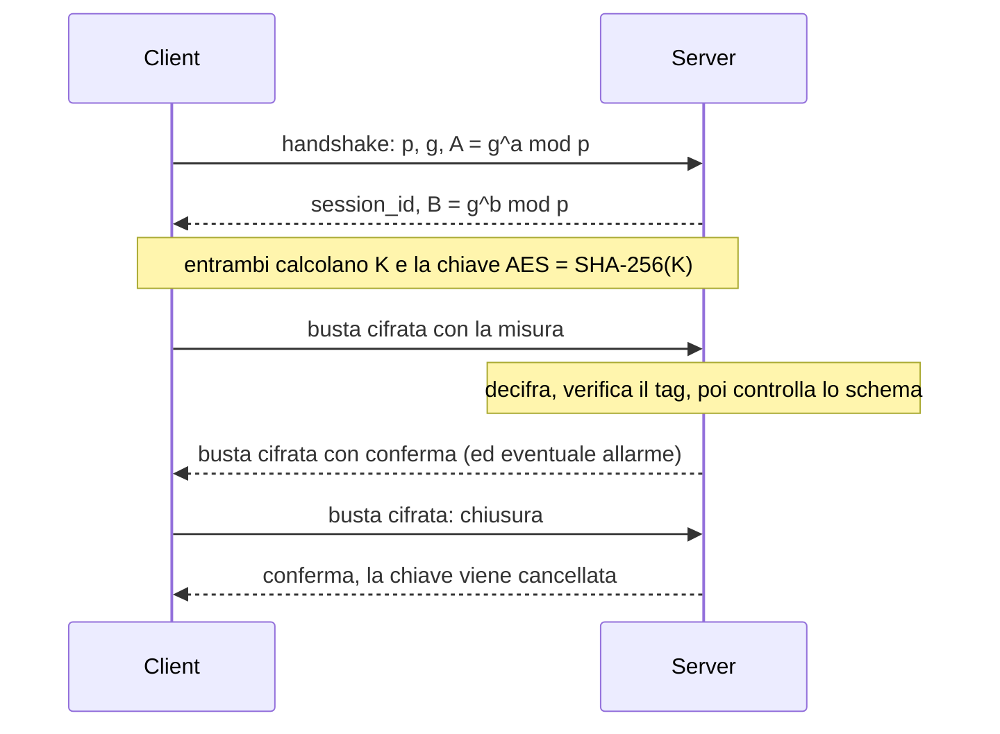

# FrigoTrack

Sistema client-server in C# (.NET 8) per controllare la temperatura di celle frigo e camion. Tre sensori simulati mandano le misure a un server. I messaggi sono cifrati con AES-256-GCM, con una chiave concordata tramite Diffie-Hellman, e sono controllati con JSON Schema.

## Come si avvia

1. Apri `FrigoTrack.sln` con Visual Studio.
2. Avvia il server: tasto destro su `FrigoTrack.Server` > *Imposta come progetto di avvio*, poi *Debug > Avvia senza eseguire debug*. Nella finestra deve comparire `Now listening on: http://127.0.0.1:5000`.
3. Avvia il client: tasto destro su `FrigoTrack.Client` > *Debug > Avvia nuova istanza*.
4. Per i test: *Test > Esegui tutti i test*.

Con `--invalid` il client manda anche una misura non valida, per vedere come il server la rifiuta.

## Struttura

| File | Cosa fa |
|---|---|
| `FrigoTrack.Common/Dh.cs` | Diffie-Hellman con `BigInteger.ModPow` (gruppo 14 di RFC 3526, 2048 bit) |
| `FrigoTrack.Common/SecureBox.cs` | Cifra e decifra le buste con AES-256-GCM |
| `FrigoTrack.Common/SchemaValidator.cs` | Controlla i messaggi con gli schemi JSON |
| `FrigoTrack.Server/ServerApp.cs` | Server: endpoint, sessioni, salvataggio delle misure |
| `FrigoTrack.Client/` | Client con i 3 sensori |
| `schemas/` | Un file JSON Schema per ogni tipo di messaggio |
| `FrigoTrack.Tests/` | Test xUnit |

## Come funziona

La chiave non passa mai in rete. Dopo l'handshake si vede solo la busta `{session_id, nonce, ciphertext, tag}` con i dati in Base64.

## Endpoint

| Endpoint | Richiesta | Risposta |
|---|---|---|
| `POST /api/handshake` | `{p, g, A}` in chiaro | `{session_id, B}` |
| `POST /api/telemetry` | busta con la misura | busta con `{status, received_at, alarm?}` |
| `POST /api/readings` | busta con i filtri (`sensor_id`, `from`, `to`, `limit`) | busta con `{count, readings}` |
| `POST /api/close` | busta con `{action: "close"}` | busta con `{status: "closed"}` |

Una misura ha `sensor_id`, `timestamp`, `cargo_type` (`food`, `pharma`, `frozen`) e `temperature_c`. Facoltativi: `humidity` e `battery`.

L'allarme scatta se la temperatura esce da questi intervalli:

| Merce | Intervallo |
|---|---|
| `pharma` | 2 … 8 °C |
| `food` | 0 … 4 °C |
| `frozen` | −25 … −18 °C |

## Codici di risposta

| Codice | Quando |
|---|---|
| 200 | tutto ok |
| 400 | busta malformata, tag non valido, messaggio non valido (con il nome del campo sbagliato) |
| 401 | sessione inesistente |
| 404 | endpoint inesistente |
