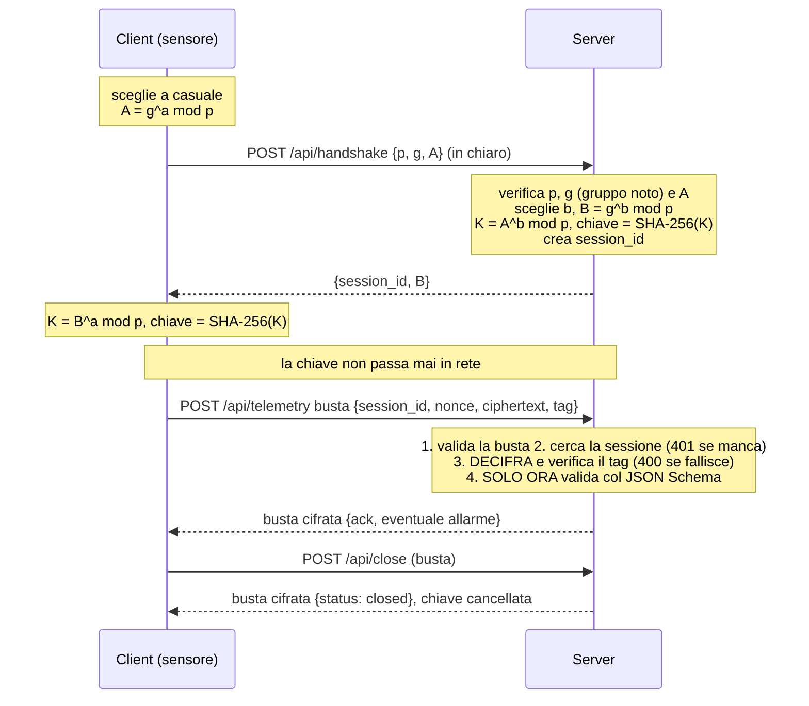

# FrigoTrack – telemetria sicura per la catena del freddo (C# / .NET 8)

Sistema client-server HTTP. Dei sensori di temperatura (celle frigo, camion) inviano misure JSON a un server. I messaggi sono **cifrati con AES-256-GCM** usando una chiave concordata con **Diffie-Hellman scritto a mano**, e sono **validati con JSON Schema**.

Per i passaggi guidati, consulta anche `GUIDA_SEMPLICE.md`.

## Come si avvia (da Visual Studio)

1. Apri `FrigoTrack.sln`.
2. Avvia il **server**: tasto destro su `FrigoTrack.Server` > *Imposta come progetto di avvio*, poi **Ctrl+F5**. Si apre una finestra nera con la scritta `Now listening on: http://127.0.0.1:5000`. Lasciala aperta.
3. Avvia il **client**: tasto destro su `FrigoTrack.Client` > *Debug* > *Avvia nuova istanza*.
4. Test: menu **Test > Esegui tutti i test**.

Da riga di comando: `dotnet run --project FrigoTrack.Server`, poi in un altro terminale `dotnet run --project FrigoTrack.Client -- --interval 1 --count 5 --invalid`, e `dotnet test`.

Opzioni del client: `--url`, `--interval` (secondi tra due misure), `--count` (misure per sensore), `--invalid` (invia anche una misura non valida, per la demo). Opzioni del server: `--host`, `--port`, `--data`.

## Struttura

| Progetto / file | Ruolo |
|---|---|
| `FrigoTrack.Common/Dh.cs` | Diffie-Hellman: `A = g^a mod p`, `K = B^a mod p` con `BigInteger.ModPow`; gruppo 14 di RFC 3526 (2048 bit) |
| `FrigoTrack.Common/SchemaValidator.cs` | Validatore JSON Schema; indica il campo sbagliato |
| `FrigoTrack.Common/SecureBox.cs` | Busta cifrata AES-256-GCM (`Seal` per cifrare, `Open` per decifrare) |
| `FrigoTrack.Server/ServerApp.cs` | Server ASP.NET Core: endpoint, sessioni, archivio JSON |
| `FrigoTrack.Server/Program.cs` | Avvio e lettura delle opzioni |
| `FrigoTrack.Client/SecureClient.cs` | Una sessione cifrata: handshake, invio, risposta |
| `FrigoTrack.Client/Program.cs` | I 3 sensori simulati |
| `schemas/*.json` | Un file per ogni tipo di messaggio (10 schemi) |
| `FrigoTrack.Tests/` | Test xUnit (test sui requisiti principali) |

## Handshake (diagramma di sequenza)



La chiave AES è `SHA-256(K)` (32 byte). In rete si vede in chiaro solo il `session_id`.

## Messaggi

| Endpoint | Richiesta (schema) | Risposta (schema) |
|---|---|---|
| `POST /api/handshake` | `handshake_request` `{p, g, A}` (esadecimale, in chiaro) | `handshake_response` `{session_id, B}` |
| `POST /api/telemetry` | busta (`envelope`) con `telemetry` | busta con `telemetry_ack`: `{status, received_at, alarm?}` |
| `POST /api/readings` | busta con `readings_request`: `{sensor_id?, from?, to?, limit?}` | busta con `readings_response`: `{count, readings[]}` |
| `POST /api/close` | busta con `close_request` `{action:"close"}` | busta con `close_response` `{status:"closed"}` |

**Busta** (`envelope.json`): `{"session_id", "nonce", "ciphertext", "tag"}`, con i campi binari in Base64. Il `nonce` (96 bit casuali per ogni messaggio) serve ad AES-GCM. Il `session_id` è usato come dato associato (AAD): una busta non si può spostare su un'altra sessione.

**Misura** (`telemetry.json`): `sensor_id` (es. `CELLA-BG-007`), `timestamp` (RFC 3339), `cargo_type` (`food`, `pharma`, `frozen`), `temperature_c` (−40…40), e facoltativi `humidity` (0…100) e `battery` (0…100, intero).

**Allarme**: se la temperatura esce dall'intervallo del tipo di merce, l'ack contiene `alarm`.

| cargo_type | intervallo sicuro |
|---|---|
| `pharma` | 2 … 8 °C |
| `food` | 0 … 4 °C |
| `frozen` | −25 … −18 °C |

**Codici HTTP**

| Codice | Quando |
|---|---|
| 200 | tutto ok |
| 400 | busta malformata, tag o decifratura falliti, messaggio non valido (indica il campo), handshake con parametri non accettati |
| 401 | `session_id` inesistente |
| 404 | endpoint inesistente (o metodo sbagliato) |

**Errori** (`error.json`): `{status, error, message, field}`. Se il messaggio è stato decifrato correttamente, l'errore (che cita il campo sbagliato, per esempio `temperature_c`) viaggia in una busta cifrata. Se la busta è malformata o manomessa, l'errore è generico e in chiaro, senza dettagli.

```json
{"status": 400, "error": "invalid_message",
 "message": "campo 'temperature_c' non valido: 99 e' maggiore del massimo 40",
 "field": "temperature_c"}
```
